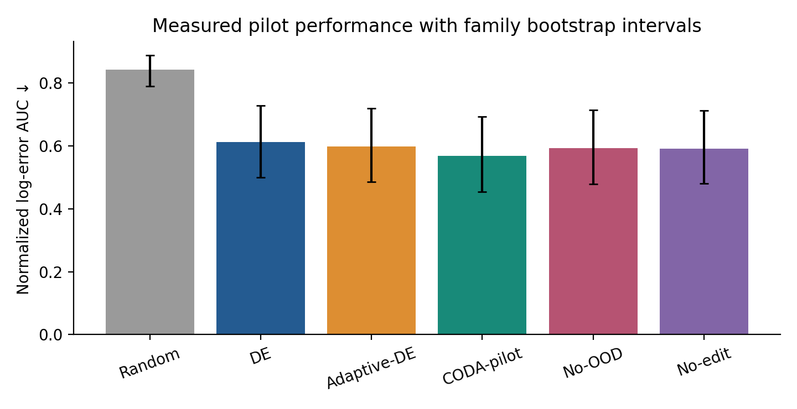
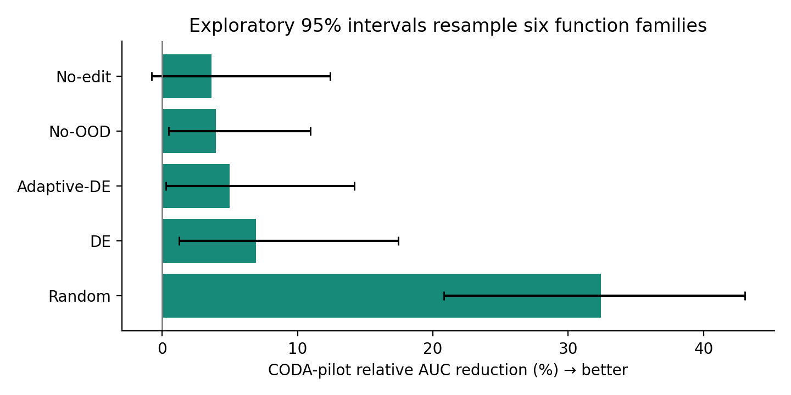
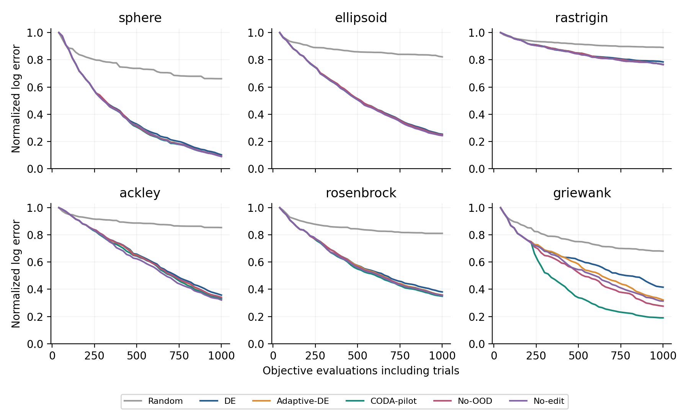

# CODA-BBO: Budget-Aware Black-Box Optimization

A reproducible research pilot exploring **when a black-box optimizer should keep its current search strategy, adjust its parameters, or try a different combination of operators**.

CODA-BBO stands for *Continual OOD-Aware Dynamic Algorithm Design*. This repository contains the **stage-zero experiment** associated with the doctoral research proposal. The long-term project investigates transfer risk, online algorithm design, and continual learning. The code here is deliberately smaller: it is a transparent, executable starting point for testing those ideas.

> **Scope:** This is a static, deterministic optimization pilot. It does **not** implement a learned optimizer generator, calibrated prediction of harmful transfer, continual memory, or objective-drift handling. The OOD score is a handcrafted novelty statistic, not a transfer-risk probability.

## What is included?

- Six shifted analytic function families: Sphere, Ellipsoid, Rastrigin, Ackley, Rosenbrock, and Griewank.
- Six methods, including random search, differential evolution (DE), heuristic adaptation, and three CODA-related variants.
- A shared objective-evaluation budget that **charges candidate trials and discarded branches**.
- A fixed novelty threshold fitted only on reference families.
- Twelve automated checks for execution contracts and reproducibility.
- Raw experimental records, family-level summaries, figures, and a DOI metadata audit.

## Experimental setup

| Setting | Stage-zero experiment |
| --- | --- |
| Objective | Box-constrained, single-objective minimization |
| Search domain | `[-5, 5]^d` |
| Function families | 6 (3 reference, 3 held-out) |
| Dimensions | 5 and 10 |
| Shifted instances | 3 per family and dimension |
| Random seeds | 10 per task |
| Compared methods | 6 |
| Objective evaluations | 1,000 per run, including initialization and trials |
| Initial probes | 40 shared probes per task and seed |
| Total runs | 2,160 |
| Budgeted evaluations | 2,160,000 |
| Extra calibration evaluations | 7,200 (outside the run budgets) |

The **reference** families are Sphere, Ellipsoid, and Rastrigin. Ackley, Rosenbrock, and Griewank are **held out** when calibrating the initial novelty threshold. Family labels and known minima are used for evaluation, not as information given to the optimizer.

### Methods

| Method | What it does |
| --- | --- |
| **Random** | Samples new points uniformly throughout the box. |
| **DE** | Uses a fixed rand/1 differential-evolution proposal with binomial crossover. |
| **Adaptive-DE** | Changes DE and local-step parameters on a stagnation trigger. This is not SHADE or JADE. |
| **CODA-pilot** | Responds to initial novelty or stagnation, and tests bounded operator compositions online. |
| **No-OOD** | Keeps structural trials, but triggers them only on stagnation. |
| **No-edit** | Uses novelty/stagnation parameter adaptation without structural trials. |

The three primitive proposal operators are `de`, `local`, and `uniform`. Structural trials compare the current operator sequence with one candidate from a **small fixed pool**. Each branch gets 20 objective calls. Improvements observed in either branch count toward the best-so-far value, even when its internal population is not retained. This is appropriate for the static objectives used here and would require different bookkeeping under objective drift.

## Quick start

**Requirements:** Python 3.12 and the dependencies in `requirements.txt`.

```bash
python -m venv .venv
source .venv/bin/activate            # macOS / Linux
python -m pip install -r requirements.txt
python -m unittest -v test_pilot
python pilot.py --out results --seeds 10 --budget 1000
python analyze.py
```

On **Windows PowerShell**, activate the environment using `.venv\Scripts\Activate.ps1` instead of the `source` command.

The full default experiment requires 2,160 optimization runs; its duration depends on your machine. The provided outputs are already included, so you can inspect the data and figures without rerunning the benchmark.

**Important:** `pilot.py` writes `runs.csv`, `curves.npz`, and `manifest.json` into the chosen output directory. `analyze.py` refreshes the derived tables and figures. Back up the provided `results/` and `figures/` if you want to preserve the exact original files before rerunning. The analysis script assumes the **full default benchmark**; a smaller trial run is useful for smoke testing, but cannot be analyzed as though it contained all six families and methods.

### Create the research proposal

After the result tables and figures are available:

```bash
python build_proposal.py
```

This generates `CODA_BBO_English_Proposal.docx` from the data and narrative embedded in the builder script. It is a document-generation utility, separate from the optimization algorithm.

### Optional reference check

```bash
python verify_sources.py
```

This command requires internet access. It refreshes `results/sources.json` using Crossref and DOI redirects. **A working DOI or publisher response is not evidence of unrestricted full-text access.** There is no network requirement for the optimizer, tests, or result analysis.

## Results from the supplied pilot

The primary score is the mean **normalized log-error area under the anytime curve (AUC)**, averaged over objective evaluations 40 through 1,000. Lower is better. The normalization uses the shared initial-probe result, rather than a percentage of an unknown optimum.

| Method | Mean AUC |
| --- | ---: |
| Random | 0.8425 |
| DE | 0.6118 |
| Adaptive-DE | 0.5993 |
| **CODA-pilot** | **0.5694** |
| No-OOD | 0.5930 |
| No-edit | 0.5911 |

In these specific experiments, CODA-pilot achieved a **6.93% relative reduction** in mean AUC compared with DE. The exploratory 95% family-bootstrap interval was **[1.25%, 17.46%]**. Compared with No-edit, the estimated improvement was 3.67%, but its bootstrap interval crossed zero. The evidence therefore does **not** establish a reliable independent benefit from structural editing.

The novelty statistic achieved a family-label AUROC of **0.797** for the reference-versus-held-out split. This measures family separation, **not** harmful transfer prediction.

These findings describe only this six-family analytic pilot. There are no executed CMA-ES, SHADE, COCO/BBOB, MetaBBO, or industrial-application comparisons in this repository.

### Figures

| Aggregate AUC | Relative comparisons |
| --- | --- |
|  |  |



Additional figures: [family-level heatmap](figures/heatmap.png) · [novelty and trial diagnostics](figures/diagnostics.png).

## Repository structure

```text
.
├── pilot.py                     # Objective functions, operators, controller, budget
├── analyze.py                   # Summary tables, bootstrap intervals, plots
├── test_pilot.py                # 12 software and reproducibility tests
├── verify_sources.py            # Optional Crossref and DOI resolver audit
├── build_proposal.py            # Rebuilds the accompanying Word proposal
├── requirements.txt            # Pinned Python dependencies
├── README.md
├── GITHUB_REPOSITORY_INFO.md    # Copy-ready GitHub title, description, topics
├── SHA256SUMS.txt               # Checksums for the files in this release
├── results/
│   ├── runs.csv                 # Run-level measurements
│   ├── curves.npz               # Trajectories in runs.csv row order
│   ├── manifest.json            # Experiment configuration and environment
│   ├── summary.csv              # Method-level AUC summaries
│   ├── family_auc.csv           # Family averages
│   ├── comparisons.csv          # Relative changes and win/tie/loss counts
│   ├── final_errors.csv         # Raw final objective errors by family
│   ├── ood.json                 # Novelty diagnostic results
│   ├── tests.txt                # Captured test log from the original execution
│   └── sources.json             # DOI metadata and resolution audit
└── figures/                     # Five plots generated from measured data
```

## Reproducibility notes

1. Each method receives the same 40 initial points for a given task and seed. Subsequent randomness can diverge when the methods take different actions.
2. All calls made during initialization, ordinary search, and both trial branches consume the **same task budget**. Rejected trials do not receive a refund.
3. The initial novelty score is computed once from the probes and is not updated online. It does not detect objective drift.
4. AUC is averaged across seeds, instances, dimensions, and finally function families, with equal weight assigned to each family. The exploratory bootstrap resamples only the six **family means** (10,000 paired draws, seed `20261016`).
5. The current sample is too small to support broad claims about generalization. Final raw objective errors should be compared **within**, not across, function families.
6. Timing is hardware dependent. The included timing values and captured test output document the original run and were not regenerated merely by improving code readability.

## Research status and next steps

The pilot demonstrates that bounded operator trials and complete evaluation accounting can be implemented and measured. The next research steps are stronger solver baselines, more independent function families, action-specific transfer-loss labels, a learned risk estimator, and controlled experiments on memory and objective drift.

This repository is intended as a **transparent starting point**, not as a claim of state-of-the-art optimization performance.

## License and citation

No license was included in the supplied archive. Before publishing, add a license that you are authorized to grant (for example, MIT if you own the code and wish to permit reuse). For scholarly use, cite the accompanying proposal or a future paper when its definitive bibliographic details are available; this repository does not claim a publication DOI of its own.

Copyright

## Copyright

Copyright © 2026 Alireza Rahimipour Anaraki. All rights reserved.
This repository contains the original research implementation of CODA-BBO (Continual OOD-Aware Dynamic Algorithm Design).